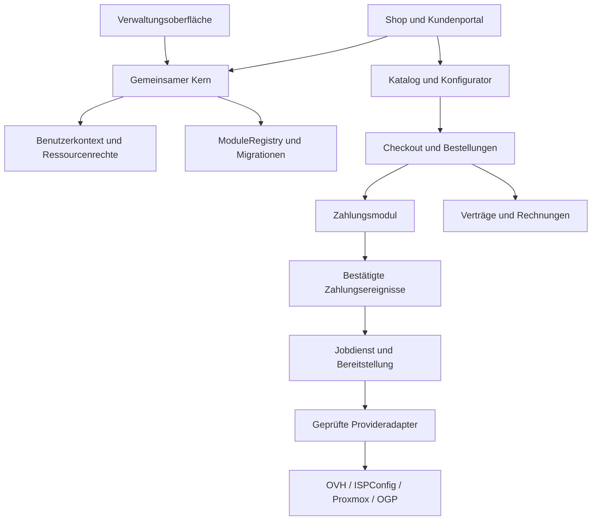

# Modulares Shopsystem auf Basis des bestehenden Projekts

Stand: 24.10.2026 · **Architekturvorschlag, noch nicht implementiert** · Umsetzung: AP18–AP27 im [Arbeitsplan](ARBEITSPLAN.md).

## Ausgangsbasis und Empfehlung

Das registrierte Projekt **„Online Shop“** unter `/mnt/c/Users/teris/Desktop/orga-consult.eu/shop` verwendet bereits dasselbe Grundframework. Der neue Einstiegspunkt ist dort `index.php`; die zusätzliche Anwendung liegt unter `shop-app/`. Untersucht wurden die öffentliche Projektdokumentation sowie insbesondere Bootstrap, Routing, Schemaaufbau, Provider-, Ressourcen-, Zahlungs- und Bereitstellungscode. Private Laufzeitkonfiguration, Zugangsdaten, Kundendaten und bestehende Rechnungsdateien wurden für diesen Vergleich nicht geöffnet.

Die passende Richtung ist ein **modularer Monolith**: ein gemeinsam nutzbarer Kern mit klaren Modulgrenzen und einem optionalen Shop-Paket. Bestehende Shopfunktionen werden nach und nach hinter diese Grenzen überführt. So können Verwaltung und Shop dieselben Kunden, Rechte und Provideradapter verwenden, während der Shop unabhängig installierbar und versionierbar bleibt.

Das vorhandene Shopsystem enthält bereits erheblich mehr als eine Oberfläche. Die Übernahme soll seinen Bestand erhalten und die Verknüpfung mit dem bereinigten Framework herstellen. Eine komplette Neuentwicklung des Warenkorbs, der Zahlungen oder der Bereitstellung wäre vor einem Abgleich dieser Funktionen nicht gerechtfertigt.

## Welche Bausteine schon vorhanden sind

Die folgende Zuordnung beschreibt vorhandenen Code. Sie ist keine erneute Sicherheits- oder Produktionsfreigabe des gesamten Shopprojekts. Insbesondere werden Aussagen älterer README-Abschnitte mit den tatsächlichen Funktionen abgeglichen: Beispielsweise existieren inzwischen eigene LXC- und Infrastrukturbausteine.

| Vorhandene Quelle in „Online Shop“ | Vorhandene Aufgabe | Vorgesehenes Ziel |
| --- | --- | --- |
| `index.php`, `shop-app/bootstrap.php`, `actions.php` | Routing, geschützte Kunden-/Adminbereiche, DB-Helfer, CSRF und Anfragebegrenzung | Gemeinsamer Bootstrap und kleine Controller; zentrale Authentifizierung/Richtlinien |
| `schema.php`, `schema-*.php`, `schema-*.sql` | Grundtabellen und schrittweise Shop-Erweiterungen | Nummerierte Kern- und Modulmigrationen mit Versionsstand |
| `providers.php`, `integrations.php`, `ovh-authorization.php` | OVH/ISPConfig/Proxmox/PayPal, Konfiguration, Zertifikate, verschlüsselte Geheimnisse | Provideradapter und Secrets-Dienst des Kerns; Zahlungsadapter im Zahlungsmodul |
| `resources.php`, `customer-visibility.php` | Kunden-/Service-Zuordnung, Provideridentität, Ressourcen-/Schreibsperren | Gemeinsame Ressourcenbindung und Zugriffsrichtlinien |
| `packages.php`, `product-modules.php`, `module-catalog.php`, `zero-base-packages.php` | Pakete, Optionen, Mengen-/Preisregeln und Konfigurator | Katalog-, Preis- und Konfiguratormodule |
| `payments.php`, `payment-reconciliation.php`, `promotion-payments.php` | Checkout, PayPal, Zahlungsprüfung und Abgleich | Checkout-/Zahlungsmodule und Ereignisverarbeitung |
| `provisioning.php`, `worker.php` | Bereitstellung in Phasen, Hintergrundverarbeitung, Wiederholung/Prüfbedarf | Gemeinsamer Jobdienst plus separate Bereitstellungsadapter |
| `domain-ordering.php`, `domains.php`, `dns-templates.php` | Domainangebote, Registrierung, Preise und DNS-Vorlagen | Domain-/DNS-Shopmodul |
| `hosting-panel.php`, `hosting-*.php` | Hosting-, FTP-, Datenbank-, Mail- und Domainverwaltung | Kundenfunktionen des Hosting-Moduls |
| `lxc-provisioning.php`, `infrastructure.php`, `infrastructure-automation.php`, `vps-*.php` | VM/LXC-Bereitstellung, Ressourcen/IPs, Vorlagen, Runner und VPS-Sicherungen | Infrastruktur-/Bereitstellungs-/Sicherungsmodule mit klaren Betriebsrechten |
| `module-subscriptions.php` | Kaufbare Zusatzoptionen, Rechte/Limits und deren Ende | Leistungs-/Zusatzpaketmodul |
| `invoices.php`, `billing.php`, `offers.php`, `receivables.php` | Belege/PDF, Angebote, Forderungen | Rechnungs-/Angebotsmodule |
| `contracts.php`, `contract-*.php` | Laufzeit, Verlängerung, Kündigung, manuelle Vertragsverwaltung | Vertragsmodul mit expliziten Zuständen und Historie |
| `mail.php`, `notifications.php`, `documents.php`, `faq.php` | Versand, Nachrichten, Vertragsdokumente, Hilfe | Optionale Kommunikations-/Dokument-/Hilfemodule |
| `promotions.php`, `admin-payments.php`, `order-admin.php` | Gutscheine und administrative Zahlungs-/Bestellvorgänge | Optionales Rabattmodul und klar abgesicherte Adminaktionen |
| `appearance.php`, `assets/`, `views/`, `modules.php` | Darstellung, Betreiberbranding, Portal und externe Direktzugänge | Themes, Portalansichten und konfigurierbare Verweise |

Die aktuellen `shop_*`-Tabellen und ihre IDs werden als Migrationsquelle behandelt. Globale Funktionen und ein Bootstrap mit vielen festen Includes werden schrittweise in klar zugeordnete Dienste überführt. Das bestehende Schema wird dabei nicht ungeprüft durch ein neues ersetzt.

## Drei Begriffe, die sauber definiert werden müssen

1. **Installierbares Softwaremodul:** liefert Code, eigene Konfiguration, Routen, Berechtigungen, Migrationen und gegebenenfalls Jobs. Dies wird die neue technische ModuleRegistry verwalten.
2. **Verkaufbare Produktoption/Zusatzleistung:** etwa mehr RAM, Speicher, Postfächer oder ein Zusatzabo. Diese wird im Katalog und bei den Leistungsrechten verwaltet. Ein Kunde aktiviert dadurch keinen beliebigen PHP-Code.
3. **Externer Direktzugang:** etwa Webmail oder ISPConfig. Die bestehende `shop-app/modules.php` enthält solche Verweise; Authentifizierung beim externen Dienst und eine sichere Integration werden ausdrücklich geregelt.

Alle drei können „Module“ heißen, benötigen aber eigene Daten- und Berechtigungsverträge.

## Zielaufteilung



Vorgeschlagene Verantwortlichkeiten:

| Schicht | Zuständigkeit |
| --- | --- |
| **Kern** | Konfiguration/Secrets, Benutzerkontext und Richtlinien, DB/Transaktionen, Migrationen, Logging, ModuleRegistry, Ereignis-/Jobinfrastruktur |
| **Provideradapter** | Authentifizierung, TLS, API-Aufruf, Antwortnormalisierung, Ressourcenidentität, Provider-Aufgaben und Fehlerklassifikation |
| **Shop-Basis** | Produktkatalog, Preisberechnung, Konfigurator, Anfrage/Angebot, Checkout, Bestell-Snapshot und Kundenportal |
| **Erweiterungen** | PayPal/weitere Zahlungsarten, Rechnungen, Verträge, Domainkauf, Hosting, VM/LXC, Rabatte, Dokumente, Mail und Benachrichtigungen |
| **Darstellung** | Verwaltung und Shop-Theme; Betreiberwerte und Branding als Konfiguration |

Ein zentraler Kundenkontext entscheidet über Besitzrechte. Der Provideradapter führt ausschließlich erlaubte, präzise beschriebene Operationen aus. Die fachliche Berechtigung einer Bestellung oder VM-Steuerung wird vor dem externen Aufruf geprüft.

## Vertrag für installierbare Module

Ein Manifest soll mindestens ID, Version, Kern-/PHP-Kompatibilität, Abhängigkeiten, angebotene Funktionen, benötigte Berechtigungen, Routen, Migrationen, Jobs und Konfigurationsschema beschreiben. Die Aktivierung muss prüfen, ob diese Voraussetzungen erfüllt sind.

Beispiel für den **vorgeschlagenen**, noch nicht vorhandenen Manifestvertrag:

```json
{
  "id": "shop.hosting",
  "version": "1.0.0",
  "core": "^4.0",
  "php": ">=8.4",
  "requires": ["shop.orders", "provider.ispconfig"],
  "permissions": ["hosting.view_own", "hosting.manage_own", "hosting.admin"],
  "provides": ["hosting.catalog", "hosting.provision", "hosting.customer_panel"],
  "migrations": "migrations/",
  "jobs": ["hosting.provision", "hosting.reconcile"]
}
```

- **Aktivieren:** Voraussetzungen, Schema und Rechte prüfen, danach Routen/Jobs registrieren.
- **Deaktivieren:** Neue Bestellungen/Benutzeraktionen kontrolliert sperren; laufende Jobs und bestehende Leistungen ausdrücklich behandeln. Kundendaten bleiben erhalten.
- **Aktualisieren:** Modulversion und Migration im Releaseplan prüfen; nur kompatible Kombinationen aktivieren.
- **Entfernen:** Ausstehende Verträge, Belege und Ressourcen berücksichtigen; Datenlöschung ist ein eigener ausdrücklich beauftragter Vorgang.

Neue Module werden aus vertrauenswürdigen Releasepaketen installiert. Ein öffentlicher Marktplatz für beliebigen Upload-Code ist kein Bestandteil der ersten Version.

## Datenmodell und Datenhoheit

Zentrale Entitäten sind Kunden/Benutzer, Provider-Konten, Produkte/Tarife, Produktoptionen, Bestellungen und Positionen, Zahlungen/Ereignisse, Leistungen/Ressourcenbindungen, Jobs, Verträge und Rechnungen. Jedes Modul besitzt nur die Tabellen und Änderungen seiner Zuständigkeit.

Für jede Ressource wird die Verbindung **Kunde → Leistung → Provider-Konto → externe Ressourcen-ID** gespeichert. Ein Wechsel von API-Zugang, Node, VM-Typ oder Provider-Konto erfordert einen ausdrücklichen Abgleich. Externe IDs alleine sind keine Berechtigung.

Preise werden als ganzzahlige Centbeträge mit Währung und definierten Steuer-/Rundungsregeln geführt. Eine Bestellung speichert die vereinbarte Ausstattung, Mengen, Preise, Laufzeiten und Dokumentversionen als Snapshot. Nachträgliche Tarifänderungen dürfen bestehende Vertrags- und Belegdaten nicht rückwirkend ändern.

Gemeinsame Kunden-/Supporttabellen werden vor einer Zusammenführung auf Felder, IDs, Eindeutigkeit und Statuswerte verglichen. Existierende Passworthashes bleiben erhalten, soweit sie dem gewählten Passwortverfahren entsprechen. Es wird kein zweites unverbundenes Kundenkonto pro Shop angelegt.

Verschlüsselte Daten benötigen die zugehörigen alten Schlüssel und ihren Kontext. Eine generische Installation erzeugt neue eigene Schlüssel; eine Bestandsmigration übernimmt oder verschlüsselt vorhandene Daten in einem geprüften kontrollierten Schritt neu. Produktionsschlüssel oder das Verzeichnis `private/` werden niemals als öffentliche Shopvorlage verteilt.

## Zahlung, Vertrag und Leistung als getrennte Zustände

| Objekt | Beispielzustände / wichtige Grenze |
| --- | --- |
| Bestellung | Entwurf → wartet auf Zahlung → bezahlt → in Einrichtung → abgeschlossen; Storno/Prüfbedarf separat |
| Zahlung | Angelegt → bestätigt; fehlgeschlagen, erstattet oder umstritten separat; Währung, Betrag, Empfänger und Bestellbezug prüfen |
| Leistung | Vorgemerkt → Einrichtung läuft → aktiv; Änderung, Suspendierung und Ende als eigene Vorgänge |
| Job | Bereit → beansprucht → erfolgreich; fehlgeschlagen, später erneut versuchen oder menschliche Prüfung erforderlich |
| Vertrag | Geplant → aktiv → gekündigt zum Termin → beendet; Verlängerung und Zahlungsstörung ausdrücklich abbilden |

Die genaue Zustandsmenge wird mit den vorhandenen Shopzuständen in AP21 abgeglichen. Ein Zahlungsrücksprung im Browser oder eine Abo-Freigabe reicht nicht als Zahlungsnachweis. Ein übermittelter Provider-Auftrag reicht nicht als Nachweis einer fertig eingerichteten Leistung.

Bestellabschluss und Jobeinplanung werden lokal transaktional verbunden, etwa über eine Outbox. Bestätigte Zahlungsereignisse werden anhand einer eindeutigen Provider-Event-ID einmalig verbucht. Worker beanspruchen Jobs mit zeitbegrenzter Sperre und speichern Phasen sowie externe Aufgaben-/Ressourcen-IDs.

Nach einem externen Schreib-Timeout wird zuerst abgeglichen, ob die Ressource schon angelegt wurde. Ein unklarer Domainkauf oder VM-Auftrag wird zur Prüfung angehalten; blindes Wiederholen kann doppelte Kosten oder Ressourcen verursachen. Eine Rückzahlung oder Kündigung löst keine ungeprüfte sofortige Ressourcenlöschung aus.

## Bereitstellung des Shops als Paket

Vorgeschlagene Auslieferung, endgültige Paketnamen in AP28 festlegen:

- **Kernpaket:** gemeinsame Dienste, Providerverträge und Migrationen; ohne Shop nutzbar.
- **Verwaltungspaket:** geschützte Server-/Hostingverwaltung und freigegebene Module.
- **Shop-Paket:** Katalog, Checkout und Portal mit expliziten Abhängigkeiten; optionale Zahlungen/Bereitstellung/Rechnungen ergänzbar.
- **Entwicklungs-/Beispielkonfiguration:** neutrale Betreiberwerte und dokumentierte Voraussetzungen, keine echten Zugangsdaten oder Kundendaten.

Das Webroot enthält im Zielaufbau nur den öffentlichen Einstieg und Assets. Quellcode, private Konfiguration, Logs, DB-Dateien, Belege und Backups liegen außerhalb öffentlich auslieferbarer Pfade. Betrieb über Apache oder Nginx wird mit passenden geprüften Regeln dokumentiert.

Ein Installationsdialog oder CLI-Befehl prüft Runtime, Extensions, DB, benötigte Module und Migrationen, legt einmalig den Administrator an und sperrt danach den Initialisierungsweg. Ein Hintergrundworker verarbeitet Jobs; die Verwaltung zeigt seinen tatsächlichen Heartbeat und angehaltene Aufgaben.

Auch ohne eingerichtete Zahlung/Automatisierung kann der Shop einen Anfrage-/Angebotsbetrieb anbieten. Direktkauf wird erst für vollständig eingerichtete Produkte freigeschaltet. Damit lässt sich ein neues Framework-/Shop-Paket vor echten Providerbestellungen sinnvoll abnehmen.

## Übernahme in sechs begrenzten Schritten

1. **Abgleich:** Shop-Sources, bestehende Tabellen, Routen, Jobs und Verträge inventarisieren; Versions-/Betriebsstand der tatsächlichen Installation separat feststellen.
2. **Gemeinsame Basis:** Kundenkontext, Ressourcenrechte, Konfiguration und Provideradapter hinter der neuen Kernschnittstelle verwenden. Alte Shopaufrufe zunächst über Adapter erhalten.
3. **Erster Modulausschnitt:** Katalog, Paketkonfigurator und unverbindliche Anfrage ohne externe Schreibaktion ausliefern. Branding austauschbar machen.
4. **Geschäftsabläufe ergänzen:** Zahlungsprüfung, Aufträge, Worker/Bereitstellung, Rechnung und Vertrag jeweils mit eigener Abnahme übernehmen; Hosting, Domains und VPS nacheinander freigeben.
5. **Migration proben:** Kopie des Bestands mit IDs, Summen, Ressourcenbindungen, Belegen und Schlüsseln migrieren; alte URLs und Nummernkreise prüfen. Zugangsdaten nur im kontrollierten privaten Schritt verwenden.
6. **Veröffentlichen:** Module und Kern gemeinsam paketieren, Staging prüfen, GitHub-Release veröffentlichen und dasselbe geprüfte Paket auf dem Zielserver aktivieren. Bestehende Worker vorher kontrolliert umschalten.

## Abnahme des ersten modularen Shop-Releases

- Frische Installation funktioniert mit neutralen Betreiberwerten; der Kern funktioniert auch ohne aktivierten Shop.
- Zwei Kunden sehen und steuern ausschließlich ihre eigenen Leistungen; ein normaler Nutzer kann keine Admin- oder Provider-Testaktionen ausführen.
- Produktpreise, Mengen, Laufzeiten und Limits werden ausschließlich serverseitig berechnet; deaktivierte/ungültige Produkte sind nicht kaufbar.
- Gefälschte, doppelte, verspätete und umsortierte Zahlungsereignisse führen zu keiner doppelten Zahlung, Rechnung oder Ressource.
- Ein Sandbox-Kauf kann keine echte Domain, VM oder Website anlegen.
- Ein Worker-Abbruch in jeder Bereitstellungsphase ist wiederaufnehmbar; unklare externe Resultate werden geprüft statt unkontrolliert wiederholt.
- Modulupdate/-deaktivierung bewahrt Kundendaten, bestehende Leistungsrechte, Verträge und Belege.
- Bestandsmigration bewahrt Benutzerzugang, Produkt-/Ressourcenbindung, Preis-/Vertragssnapshots und Rechnungsbezüge; Rückrollprobe ist bestanden.
- GitHub-/Uploadpakete enthalten keine privaten Laufzeitwerte, Datenbanken, Kundendokumente, Backups oder fremdes Betreiberbranding.

Weitere Zahlungsanbieter, Warenversand und Lagerhaltung, ein öffentlicher Modulmarktplatz oder mehrere voneinander unabhängige Shops sind mögliche spätere Erweiterungen. Der erste Umfang orientiert sich an den bereits vorhandenen Hosting-, Domain- und Serverprodukten.
